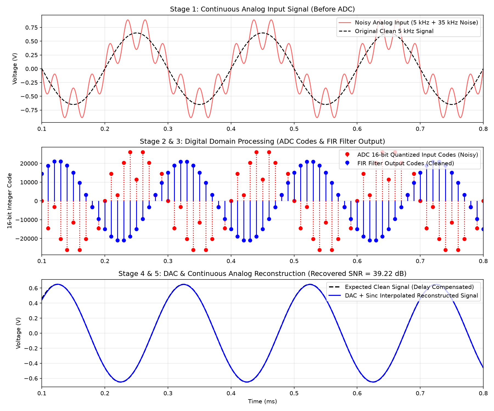

# High-Performance Pipelined FIR Filter IP

A fully parameterized, high-throughput SystemVerilog hardware IP implementing a **Finite Impulse Response (FIR) Filter**. Designed for demanding Digital Signal Processing (DSP) applications, Software-Defined Radio (SDR), audio processing, and high-speed SoC streaming architectures.

---

## 🌟 Key Features

- **Maximum Operating Frequency ($F_{\max}$) & Throughput:**
  - Fully pipelined architecture: 1 multiplication stage + $\lceil\log_2(N)\rceil$ registered binary adder stages + 1 saturation/rounding stage.
  - Zero combinational feedback paths: achieves **1 sample/cycle throughput** (sustained 100% bandwidth).
- **Streaming Interface (AXI4-Stream):**
  - Standard `s_axis_*` (Slave) and `m_axis_*` (Master) interfaces with `tvalid`, `tready`, `tdata`, and `tlast`.
  - Integrated **2-Entry Skid Buffer** on output to cleanly decouple ready/valid timing closures without bubble cycles or dropped samples.
- **Control & Configuration (AXI4-Lite):**
  - Full runtime control plane supporting ARM AMBA AXI4-Lite slave specification.
  - Runtime programmable filter coefficients ($h_0, h_1, \dots, h_{N-1}$): change filter response (Low-pass, High-pass, Band-pass) on-the-fly without FPGA re-synthesis.
  - Runtime dynamic tap scaling: select any active number of taps from $1$ to $\text{MAX\_TAPS}$.
  - Runtime output scale shift, filter enable, delay-line soft reset, and zero-latency hardware bypass.
- **Fixed-Point Arithmetic & Saturation:**
  - Full-precision internal accumulation with round-to-nearest logic ($+ 2^{\text{shift}-1}$).
  - Two's complement signed saturation logic: prevents audio/signal wrap-around distortion and flags sticky `OVERFLOW` in the status register.

---

## 📐 Architecture Overview

```text
                                  +-------------------------------------------------------------+
                                  |                     fir_filter_top                          |
                                  |                                                             |
   s_axis_tdata (Signed 16-bit)   |   +-----------------------+     +-----------------------+   |   m_axis_tdata
  ===============================>|-->|  fir_core_pipelined   |---->| axi_stream_skid_buf   |-->|=================>
   s_axis_tvalid / s_axis_tready  |   |  - Delay Line         |     | - 2-entry ping-pong   |   |   m_axis_tvalid
   s_axis_tlast                   |   |  - Mult Stage         |     | - Decoupled timing    |   |   m_axis_tready
                                  |   |  - Pipelined AdderTree|     +-----------------------+   |   m_axis_tlast
                                  |   |  - Round & Saturate   |                                 |
                                  |   +-----------------------+                                 |
                                  |               ^                                             |
                                  |               | Config / Coeffs                             |
                                  |               v                                             |
   s_axi_aw*, s_axi_w*            |   +-----------------------+                                 |
  ===============================>|-->|  axi4_lite_regfile    |                                 |
   s_axi_ar*, s_axi_r*            |   |  - Control / Status   |                                 |
   (AXI4-Lite 32-bit Control Bus) |   |  - Dynamic Coeff RAM  |                                 |
                                  |   +-----------------------+                                 |
                                  +-------------------------------------------------------------+
```

---

## 📈 End-to-End Physical DSP Verification

The repository includes a complete physical verification script [`tb/end_to_end_dsp_chain.py`](tb/end_to_end_dsp_chain.py) demonstrating the complete analog-to-digital signal flow:
1. **Continuous-Time Analog Input:** $5.0\text{ kHz}$ audio tone $+ 35.0\text{ kHz}$ high-frequency noise.
2. **16-bit ADC Model:** Quantization into **$65{,}536$ discrete voltage levels** ($\text{LSB} \approx 30.518\ \mu\text{V}$) with two's complement integer encoding.
3. **Digital FIR Filter IP:** Hardware fixed-point core filters out stopband noise.
4. **16-bit DAC & Sinc Reconstruction:** Converts discrete codes back to analog voltage and reconstructs the continuous waveform using Whittaker-Shannon Sinc Interpolation.
5. **Noise Elimination:** High-frequency noise is eliminated, recovering the original $5\text{ kHz}$ sine wave with an **SNR of $39.22\text{ dB}$**!



> 📖 **Detailed Technical Guide:** For full mathematical derivations, frequency response curves, and design methodologies, refer to the [**FIR Filter Design Guide**](docs/FIR_Filter_Design_Guide.md).

---

## 🔌 Hardware Parameters

| Parameter | Default | Description |
| :--- | :--- | :--- |
| `DATA_WIDTH` | `16` | Bit width of incoming and outgoing audio/RF signal samples (signed). |
| `COEFF_WIDTH` | `16` | Bit width of filter impulse response coefficients (signed Q15). |
| `MAX_TAPS` | `16` | Maximum number of filter taps hardware can support (e.g. 8, 16, 32, 64). |
| `AXI_ADDR_WIDTH`| `8` | Address bus width for AXI4-Lite control interface. |
| `AXI_DATA_WIDTH`| `32` | Data bus width for AXI4-Lite control interface. |
| `DEF_SCALE` | `15` | Default right-shift scaling factor (15 for Q15 fixed-point unity gain). |

---

## 📋 AXI4-Lite Register Map

All registers are 32-bit word-aligned:

| Offset Address | Register Name | Access | Bit Field Description |
| :--- | :--- | :---: | :--- |
| **`0x00`** | `CTRL_REG` | R/W | • **Bit 0**: `ENABLE` (1 = Filter Active, 0 = Disabled).<br>• **Bit 1**: `SOFT_RESET` (Self-clearing pulse; flushes sample delay line to 0).<br>• **Bit 2**: `BYPASS` (1 = Pass input directly to output, 0 = Filtered output). |
| **`0x04`** | `STATUS_REG` | R/W1C | • **Bit 0**: `ACTIVE` (Read-only; 1 when samples are in flight).<br>• **Bit 1**: `OVERFLOW` (Sticky bit; set on saturation. Write 1 to clear). |
| **`0x08`** | `ACTIVE_TAPS` | R/W | Number of active taps ($1 \le N \le \text{MAX\_TAPS}$). Default: `MAX_TAPS`. |
| **`0x0C`** | `SCALE_REG` | R/W | Right-shift amount for fixed-point output scaling ($0 \le \text{shift} \le 31$). |
| **`0x40`** | `COEFF_0` | R/W | Impulse response tap 0 coefficient ($h[0]$). |
| **`0x44`** | `COEFF_1` | R/W | Impulse response tap 1 coefficient ($h[1]$). |
| **...** | ... | R/W | ... |
| **`0x40 + 4*(N-1)`** | `COEFF_N-1` | R/W | Impulse response tap $N-1$ coefficient ($h[N-1]$). |

---

## 📁 Repository Structure

```text
FIR_Filter/
├── Makefile                  # Root Makefile for one-command build, test, and simulation
├── requirements.txt          # Python dependencies (numpy, matplotlib)
├── docs/
│   ├── FIR_Filter_Design_Guide.md # Full technical guide & mathematical derivations
│   └── images/
│       └── end_to_end_dsp_chain.png # High-resolution DSP verification waveform
├── rtl/
│   ├── fir_adder_stage.sv        # Individual pipelined stage in binary adder tree
│   ├── fir_core_pipelined.sv     # Pipelined multipliers, adder tree, rounder & saturator
│   ├── axi_stream_skid_buffer.sv # 2-entry ping-pong skid buffer for clean timing closure
│   ├── axi4_lite_regfile.sv      # AXI4-Lite Slave CSR with dynamic coefficient RAM
│   └── fir_filter_top.sv         # Top-level IP integrating Stream and Lite interfaces
├── tb/
│   ├── fir_golden_model.py       # Parameterized golden model & stimulus generator
│   ├── end_to_end_dsp_chain.py   # Physical ADC -> FIR -> DAC -> Interpolation chain
│   └── fir_filter_top_tb.sv      # Self-checking SystemVerilog testbench (7 comprehensive tests)
├── sim/
│   ├── Makefile                  # Local simulation Makefile
│   └── run_sim.sh                # Executable one-click bash simulation runner
└── README.md
```

---

## 🚀 Quick Start & Simulation

### 1. Python Environment (Optional / Automated)
You can create an isolated virtual environment with all required dependencies:
```bash
make venv
```

### 2. Run Self-Checking RTL Simulation (QuestaSim)
Execute the complete compilation and test suite in batch mode:
```bash
make sim
```
Or with QuestaSim GUI waveforms:
```bash
make sim_gui
```

### 3. Run End-to-End DSP Physical Simulation
Run the full ADC $\to$ FIR $\to$ DAC $\to$ Interpolation simulation and generate plots:
```bash
make dsp_chain
```

### 4. Clean Build Artifacts
```bash
make clean
```
