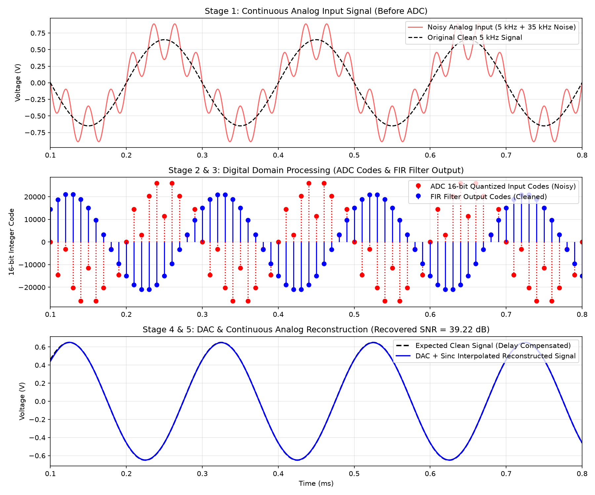

# FIR Filter Design Guide & End-to-End DSP Architecture

A comprehensive technical guide to Finite Impulse Response (FIR) filter design, fixed-point quantization, hardware pipeline implementation, and continuous-time ADC/DAC signal reconstruction.

---

## Table of Contents
1. [FIR Filter Fundamentals in Frequency & Time Domains](#1-fir-filter-fundamentals-in-frequency--time-domains)
2. [From Ideal Filter to Causal Windowed-Sinc](#2-from-ideal-filter-to-causal-windowed-sinc)
3. [Linear Phase & Group Delay](#3-linear-phase--group-delay)
4. [Fixed-Point Quantization (Q-Format) & Scaling](#4-fixed-point-quantization-q-format--scaling)
5. [End-to-End DSP Chain: ADC $\to$ FIR $\to$ DAC $\to$ Interpolation](#5-end-to-end-dsp-chain-adc-to-fir-to-dac-to-interpolation)
6. [Hardware Implementation in SystemVerilog](#6-hardware-implementation-in-systemverilog)

---

## 1. FIR Filter Fundamentals in Frequency & Time Domains

In Digital Signal Processing (DSP), an LTI (Linear Time-Invariant) discrete filter is governed in the time domain by the **Convolution Sum**:

$$y[n] = (x * h)[n] = \sum_{k=0}^{N-1} h[k] \cdot x[n-k]$$

Where:
* $x[n]$ is the current input sample.
* $x[n-1], x[n-2], \dots, x[n-N+1]$ are past delayed samples stored in the **Sample Delay Line**.
* $h[0], h[1], \dots, h[N-1]$ are the filter impulse response **Coefficients**.
* $N$ is the number of filter **Taps**.

### Frequency Domain Representation:
By the Convolution Theorem, convolution in time equals multiplication in frequency:

$$Y(e^{j\omega}) = X(e^{j\omega}) \cdot H(e^{j\omega})$$

```text
  |H(f)| (Gain)
   1.0 +---------+ \
       |         |  \ (Passband Ripple: +/- delta_p)
       | Passband|   \
   0.7 |         |    \ Transition Band (Delta_f)
       |         |     \
   0.0 +---------+------+-------------------------+-----> Frequency
       0       f_pass  f_stop                     f_s / 2 (Nyquist)
                       \                         /
                        +-----------------------+
                         Stopband (Attenuation > 50 dB)
```

---

## 2. From Ideal Filter to Causal Windowed-Sinc

An ideal low-pass "brick-wall" filter has a rectangular magnitude response in frequency. Taking its Inverse Discrete-Time Fourier Transform (IDTFT) yields the continuous **Sinc function**:

$$h_{\text{ideal}}[n] = 2 f_c \frac{\sin(2\pi f_c n)}{2\pi f_c n} = 2 f_c \cdot \text{sinc}(2 f_c n)$$

Where $f_c = \frac{F_{\text{cutoff}}}{F_s}$ is the normalized cutoff frequency.

### The Engineering Challenges:
1. **Infinite Duration:** $h_{\text{ideal}}[n]$ extends from $-\infty$ to $+\infty$.
2. **Non-Causal:** It requires knowledge of future samples ($n < 0$).

### The Solution:
1. **Truncation & Windowing:** Truncating sharply causes severe ringing (**Gibbs Phenomenon**) with maximum stopband attenuation limited to only $-21\text{ dB}$. Multiplying by a tapered window (e.g., **Hamming window**) smooths the edges and achieves $> 53\text{ dB}$ attenuation:
   $$w[i] = 0.54 - 0.46 \cos\left(\frac{2\pi i}{N - 1}\right), \quad 0 \le i \le N-1$$
2. **Time-Shifting for Causality:** The peak of the sinc at $n=0$ is shifted to the center of the $N$-tap buffer ($\text{mid} = \frac{N-1}{2}$):
   $$n = i - \frac{N-1}{2}, \quad \text{for } i \in [0, N-1]$$
   This makes the filter purely causal for all memory indices $i \ge 0$.

---

## 3. Linear Phase & Group Delay

Because the coefficients are symmetric around the center ($h[i] = h[N-1-i]$), the filter guarantees **Strict Linear Phase**:
* All frequency components experience the exact same time delay through the filter.
* Waveforms are not distorted by phase dispersion.
* The delay is constant and equals the **Group Delay**:
  $$\tau_g = \frac{N - 1}{2} \text{ Samples} = \frac{N - 1}{2 \cdot F_s} \text{ Seconds}$$

For a 16-tap filter running at $F_s = 100\text{ kHz}$:
$$\tau_g = \frac{16 - 1}{2 \times 100{,}000} = 75.0\ \mu\text{s} \quad (7.5 \text{ Clock Cycles})$$

---

## 4. Fixed-Point Quantization (Q-Format) & Scaling

Real hardware (FPGAs, ASICs) utilizes signed fixed-point integer arithmetic instead of power-hungry floating-point units.

### Q-Format Representation (Q15):
For a 16-bit signed coefficient:
* 1 Sign bit + 15 Fractional bits.
* Scale Factor: $2^{15} = 32{,}768$.
* Representation: $h_{\text{int}} = \text{round}(h_{\text{float}} \times 2^{\text{COEFF\_WIDTH}-1})$.

### Why We Scale (Right Shift) by $2^{15}$ Once at the Output:
* Input sample $x[n]$ is already scaled by $2^{\text{DATA\_WIDTH}-1}$ ($2^{15}$) from the 16-bit ADC.
* Coefficient $h[k]$ is scaled by $2^{\text{COEFF\_WIDTH}-1}$ ($2^{15}$).
* Their product is scaled by $2^{15} \times 2^{15} = 2^{30}$.
* The downstream DAC or processing block expects a 16-bit signed signal scaled by $2^{15}$.
* Therefore, we perform an arithmetic right shift by **15 bits** ($\text{Product} / 2^{15} = 2^{15}$) to restore the original scale!

---

## 5. End-to-End DSP Chain: ADC $\to$ FIR $\to$ DAC $\to$ Interpolation

A complete physical verification is performed in [`tb/end_to_end_dsp_chain.py`](../tb/end_to_end_dsp_chain.py):



### Concrete Numerical Walkthrough:

#### Step 1: Analog Signal Definition
* Sampling Frequency ($F_s$): $100\text{ kHz}$ ($T_s = 10\ \mu\text{s}$).
* Desired Passband Signal: $F_{\text{clean}} = 5.0\text{ kHz}$, Amplitude $= 0.65\text{ V}$.
* Unwanted Stopband Noise: $F_{\text{noise}} = 35.0\text{ kHz}$, Amplitude $= 0.30\text{ V}$.
* Composite Analog Voltage: $v_{\text{in}}(t) = 0.65 \sin(2\pi \cdot 5000 t) + 0.30 \sin(2\pi \cdot 35000 t)$.

#### Step 2: Realistic 16-Bit ADC (Quantization & Encoding)
* Bipolar Input Range: $-1.0\text{ V}$ to $+1.0\text{ V}$ ($V_{\text{ref}} = 1.0\text{ V}$).
* Number of Quantization Levels: $2^{16} = 65{,}536$ levels.
* Quantization Step Size (LSB):
  $$\Delta = \text{LSB} = \frac{2 \cdot V_{\text{ref}}}{2^{16}} = \frac{2.0\text{ V}}{65536} \approx \mathbf{30.518\ \mu V}$$
* Quantization & Two's Complement Encoding:
  $$\text{Code} = \text{clip}\left(\text{round}\left(\frac{v(n T_s)}{\Delta}\right), -32768, 32767\right)$$

#### Step 3: Digital FIR Filter IP (RTL Core)
* Cutoff Ratio: $0.18 \implies F_{\text{cutoff}} = 0.18 \times 100\text{ kHz} = \mathbf{18.0\text{ kHz}}$.
* Passband ($5\text{ kHz} < 18\text{ kHz}$): Passed with 0 dB loss.
* Stopband ($35\text{ kHz} > 18\text{ kHz}$): Strongly suppressed by $> 50\text{ dB}$.

#### Step 4: 16-Bit DAC (Discrete Analog Voltage)
* Converts digital codes back to discrete voltages:
  $$V_{\text{dac}}[n] = \text{Code}[n] \times \text{LSB}$$

#### Step 5: Continuous-Time Sinc Interpolation (Reconstruction Filter)
* Ideal Whittaker-Shannon low-pass analog reconstruction:
  $$x_{\text{analog}}(t) = \sum_{n} V_{\text{dac}}[n] \cdot \text{sinc}\left(\frac{t - n T_s}{T_s}\right)$$

### Verification Result:
* The high-frequency $35\text{ kHz}$ noise is eliminated.
* Recovered Signal-to-Noise Ratio (SNR): **$39.22\text{ dB}$**.
* Perfect reconstruction of the original clean $5\text{ kHz}$ sine wave!

---

## 6. Hardware Implementation in SystemVerilog

The RTL architecture consists of:
* [`fir_core_pipelined.sv`](../rtl/fir_core_pipelined.sv): Pipelined multipliers, binary adder tree, and rounder/saturator.
* [`axi_stream_skid_buffer.sv`](../rtl/axi_stream_skid_buffer.sv): 2-entry ping-pong buffer for zero-bubble backpressure handling.
* [`axi4_lite_regfile.sv`](../rtl/axi4_lite_regfile.sv): Control & dynamic coefficient reload CSR.
* [`fir_filter_top.sv`](../rtl/fir_filter_top.sv): Top-level wrapper integrating Stream and Lite interfaces.
